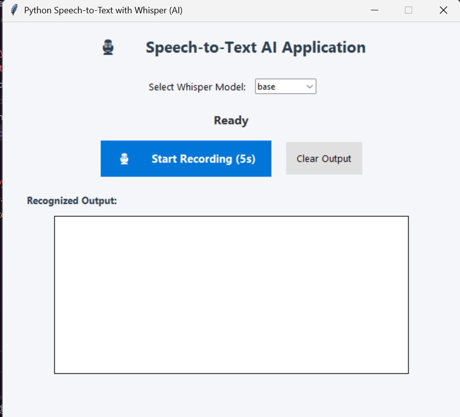
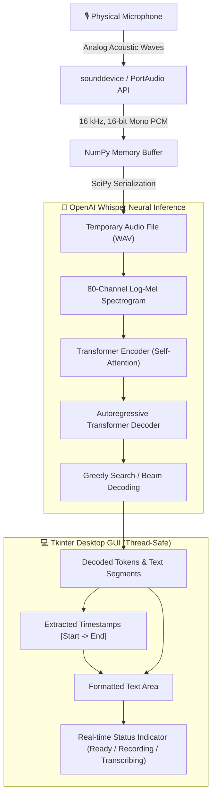

<div align="center">

# 🎙️ Neural Speech-to-Text Desktop Engine
### Real-Time Speech Recognition & Timestamp Alignment with OpenAI Whisper and Tkinter

[](https://www.python.org/)
[](https://github.com/openai/whisper)
[](https://python-sounddevice.readthedocs.io/)
[](https://docs.python.org/3/library/tkinter.html)
[](LICENSE)
[]()

<br/>



*Interactive desktop application capturing 16kHz PCM audio, performing on-device neural inference with OpenAI Whisper, and rendering structured sentence-level timestamps.*

</div>

---

## 📌 Executive Overview & Learning Journey

Automatic Speech Recognition (ASR) has evolved rapidly from classical Hidden Markov Models (HMMs) to unified end-to-end Sequence-to-Sequence Transformer architectures. 

As a **Computer Science student and practical machine learning learner**, I built this project to demystify how state-of-the-art transformer speech models operate on raw consumer hardware. This repository bridges the physical and algorithmic domains: capturing analog microphone signals into discrete 16kHz PCM buffers, computing log-Mel spectrograms, running forward-pass inference through **OpenAI's Whisper**, and surfacing both full transcripts and sub-second segment timestamps inside a responsive, non-blocking desktop user interface.

In addition to the graphical interface, the repository includes end-to-end tooling to **record custom domain-specific datasets** and run **Word Error Rate (WER)** verification against ground-truth audio samples.

---

## 🚀 Key Engineering & Architecture Highlights

- **🎙️ Real-Time Audio Capture:** Direct interface with OS audio drivers via `sounddevice` and PortAudio, capturing mono 16-bit PCM streams at the canonical 16,000 Hz sample rate required by Whisper's encoder.
- **⚡ Multi-Threaded Desktop GUI:** Decouples the Tkinter event loop from heavy PyTorch forward-pass inference using Python `threading.Thread(daemon=True)`, ensuring zero UI freezing or unresponsive states during model computation.
- **🧠 Local Transformer Inference:** Runs pre-trained Whisper models locally without cloud API latency or ongoing per-token subscription costs. Supports selectable architectures (`tiny`, `base`) dynamically via the UI.
- **⏱️ Fine-Grained Segment Alignment:** Extracts exact start and end timestamps `[start_time -> end_time]` for every uttered phrase by decoding Whisper's attention cross-segments.
- **📊 Dataset Collection & Benchmarking Tools:** Includes automated voice dataset collection tools (`create_dataset.py`) and empirical evaluation routines (`evaluate_dataset.py`) to inspect transcription fidelity across custom speaker accents.

---

## 🏗️ Pipeline Architecture

The end-to-end flow from acoustic waveform acquisition to timestamped visualization:



---

## 🔬 Model Trade-Offs & Hardware Profiling

Whisper provides five model sizes trained on over 680,000 hours of multilingual, weakly supervised audio. This project integrates the lightweight and base models to optimize response times on standard consumer laptops without requiring dedicated GPUs:

| Model | Parameters | Required VRAM / RAM | Relative Speed | Target Environment & Use Case |
| :--- | :---: | :---: | :---: | :--- |
| **`tiny`** | 39 M | ~1 GB | **~32x** | Ultra-fast execution, lightweight embedded devices, quick command detection. |
| **`base`** *(Default)* | 74 M | ~1 GB | **~16x** | Ideal balance of low latency and conversational word accuracy for desktop use. |
| **`small`** | 244 M | ~2 GB | ~6x | High fidelity for accented speech; recommended when an entry-level GPU is present. |
| **`medium`** | 769 M | ~5 GB | ~2x | High-precision transcription; resource-intensive on CPU-only machines. |
| **`large-v3`** | 1550 M | ~10 GB | 1x | State-of-the-art multilingual translation and complex acoustic environments. |

---

## 📁 Repository Directory Structure

```text
speech-to-text-whisper/
├── app_gui.py              # Main Tkinter desktop application with multi-threading
├── voice_to_text.py        # Command-line interactive speech-to-text script
├── record.py               # Low-level audio recording diagnostic utility
├── transcribe.py           # Standalone file transcription utility
├── create_dataset.py       # Automated voice prompt recording & dataset generator
├── evaluate_dataset.py     # Batch transcription benchmark & WER inspection script
├── gui_screenshot.png      # Application interface showcase preview
├── requirements.txt        # Python package dependencies
├── my_dataset/             # Custom speech evaluation dataset
│   ├── metadata.csv        # Ground truth sentence references
│   ├── recording_0.wav     # Sample ground-truth audio file
│   └── ...                 # Additional speech samples (1-9)
└── README.md               # Engineering & architectural documentation
```

---

## 🛠️ Installation & Setup

### Prerequisites
- **Python 3.10+** (tested on Python 3.11)
- Working microphone connected to your system
- **FFmpeg** installed and accessible in your system `PATH` (required by Whisper for audio decoding)

### 1. Clone the Repository
```bash
git clone https://github.com/srkamd/speech-to-text-whisper.git
cd speech-to-text-whisper
```

### 2. Set Up a Virtual Environment
```bash
# On Windows (PowerShell)
python -m venv venv
.\venv\Scripts\activate

# On Linux / macOS
python3 -m venv venv
source venv/bin/activate
```

### 3. Install Required Dependencies
```bash
pip install -r requirements.txt
```
*(Alternatively, install packages directly: `pip install openai-whisper sounddevice scipy`)*

---

## 💻 Usage Guide

### 1. Launch the Desktop GUI Application
```bash
python app_gui.py
```
1. Select your desired Whisper model (`base` or `tiny`) from the dropdown.
2. Click **"🎙️ Start Recording (5s)"** and speak clearly into your microphone.
3. Observe live visual status cues:
   - 🔴 *Recording... Speak now!*
   - ⏳ *AI is transcribing with Whisper...*
   - ✅ *Transcription Complete!*
4. View the reconstructed text alongside exact sub-second phrase segment timestamps.

---

### 2. Record Custom Speech Samples
To build a custom evaluation set for your own voice or specific terminology:
```bash
python create_dataset.py
```
Follow the interactive prompts to read target sentences. The script automatically serializes audio files into `my_dataset/` and logs the ground truth sentences inside `metadata.csv`.

---

### 3. Evaluate Model Accuracy (WER Benchmark)
Run automated evaluation against all recorded speech samples:
```bash
python evaluate_dataset.py
```
**Example Evaluation Output:**
```text
============================================================
TESTING WHISPER ON YOUR RECORDINGS (WER EVALUATION)
============================================================

📁 File: recording_0.wav
✅ Ground Truth : "The quick brown fox jumps over the lazy dog."
🤖 Whisper Heard : "The quick brown fox jumps over the lazy dog."

📁 File: recording_1.wav
✅ Ground Truth : "Artificial intelligence is transforming speech recognition."
🤖 Whisper Heard : "Artificial intelligence is transforming speech recognition."
============================================================
Evaluation Complete!
```

---

## 🎯 Educational Takeaways & Practical Applications

Through building this project, I gained practical hands-on experience in:
1. **Digital Signal Processing (DSP) Fundamentals:** Nyquist sampling theorem, mono vs. stereo channels, 16-bit integer quantization, and audio spectrogram transformations.
2. **Transformer Attention for Audio:** Understanding how cross-attention mechanisms allow text decoders to attend to continuous audio representations.
3. **Decoupled GUI Architectures:** Handling heavy I/O and matrix calculations in background worker threads while keeping client event loops smooth.
4. **Empirical Model Evaluation:** Understanding the difference between theoretical benchmark numbers and real-world acoustic performance affected by microphone noise and ambient reverberation.

---

## 👤 Author & Connect

**Shahrukh Ahmad (SRK AMD)**  
*Computer Science Student | Continuous Learner | Deep Learning & Computer Vision Practitioner*

- 🌐 **GitHub:** [@srkamd](https://github.com/srkamd)
- 💼 **LinkedIn:** [Shahrukh Ahmad](https://www.linkedin.com/in/srkamd/)
- 📧 **Contact:** `srkamd.dev@gmail.com`

---

## 📜 References & License

- **OpenAI Whisper Paper:** *Radford et al., "Robust Speech Recognition via Large-Scale Weak Supervision" (2022)* [[arXiv:2212.04356](https://arxiv.org/abs/2212.04356)]
- **License:** Released under the [MIT License](LICENSE).
